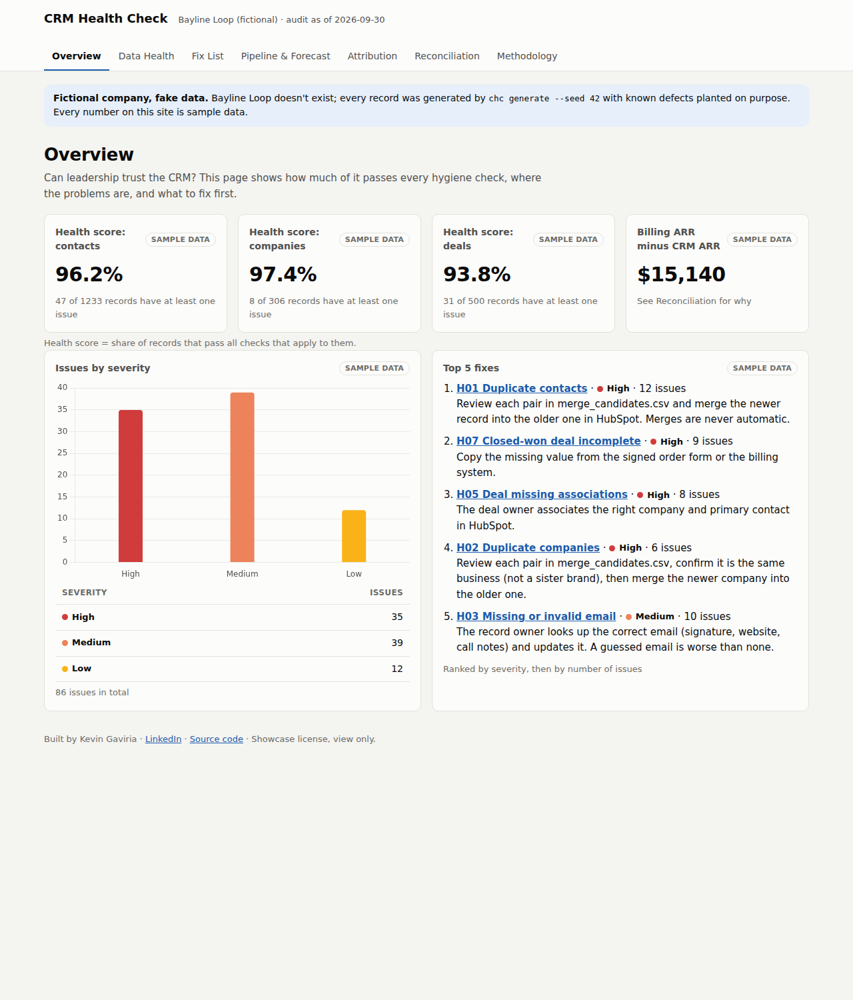
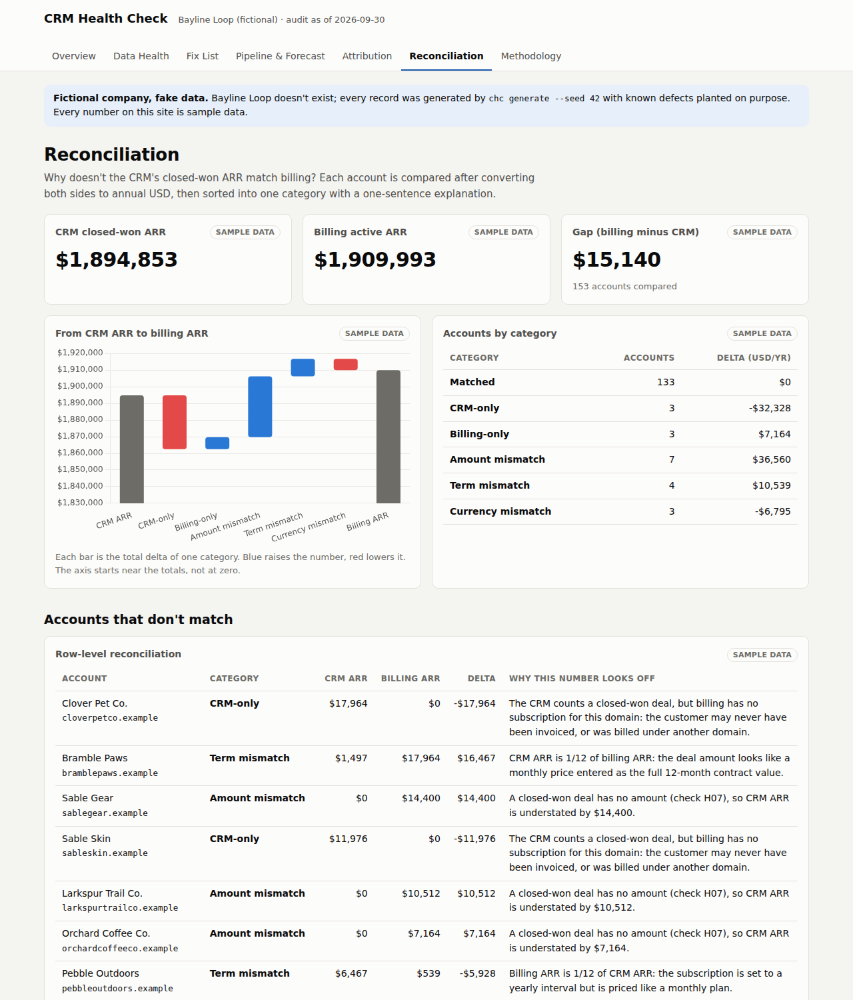
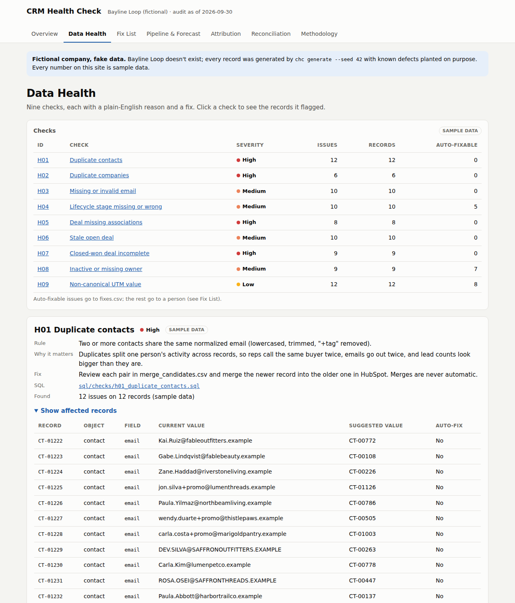
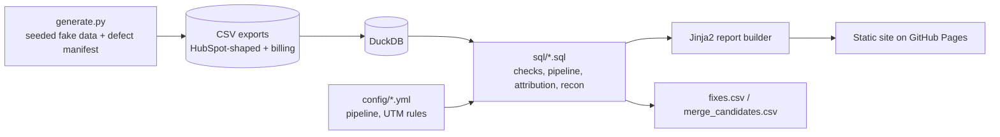

# CRM Health Check

[](https://github.com/latin-guru/crm-health-check/actions/workflows/ci.yml)
[](https://github.com/latin-guru/crm-health-check/actions/workflows/codeql.yml)

A HubSpot-style CRM audit that finds the dirty data, shows why the pipeline number doesn't match billing, and hands sales ops a ready-to-import fix list.

## 60-second summary

- **What it is:** a CRM audit and reporting toolkit (Python + DuckDB SQL) that checks CRM data hygiene, reports pipeline, forecast and attribution, and reconciles CRM closed-won ARR against a billing export.
- **Who it's for:** RevOps, sales ops and marketing ops teams who need numbers leadership can trust.
- **What it shows:** nine hygiene checks with plain-English "why it matters" text, HubSpot-import-ready fix lists, a weighted forecast, first- vs last-touch attribution before and after UTM cleanup, and a row-by-row explanation of why CRM ARR and billing ARR differ.
- **Live report:** <https://latin-guru.github.io/crm-health-check/> (static site, nothing to wait for).
- **Fictional company, fake data:** Bayline Loop, a B2B SaaS partner and affiliate tracking platform sold to online brands, doesn't exist. Every record is generated, and every number is labeled "Sample data".

## Screenshots

Captured automatically with Playwright (`scripts/screenshots.py`). All figures are sample data.

| Overview | Reconciliation | Data Health |
|---|---|---|
|  |  |  |

## The problem

Sales leaders stop trusting the CRM when duplicates, stale deals and missing values pile up, and every report quietly inherits those errors. Finance and sales then argue about revenue because the CRM and the billing system disagree and nobody can say why. This project finds the bad records, explains each one in plain English, routes the fix to the right person, and explains every CRM-vs-billing gap account by account.

## How it works



- `src/chc/generate.py` builds a clean data set, then plants known defects and lists each one in `data/defects_manifest.json`.
- `src/chc/db.py` loads the CSVs into an in-memory DuckDB database. All metric logic is plain SQL in [`sql/`](sql/).
- `src/chc/audit.py` runs the checks and splits the results into three fix lists. `src/chc/metrics.py` runs the pipeline, attribution and reconciliation SQL.
- `src/chc/report.py` renders the pages from [`templates/`](templates/) with Jinja2. Charts use Chart.js, and every chart has a table next to it.

## Checks catalog

| ID | Rule | Why it matters | Auto-fix? |
|---|---|---|---|
| H01 | Contacts share a normalized email (lowercase, trimmed, "+tag" removed) | One person's history is split; reps contact them twice | No: merge review |
| H02 | Companies share a normalized domain (no `https://`, `www.` or path) | Revenue and contacts split across copies of one account | No: merge review |
| H03 | Email missing or malformed | Can't email, dedupe or attribute the contact | No: owner |
| H04 | Lifecycle stage blank, or "customer" with no closed-won deal | Funnel and customer counts are wrong | Blank: yes (from deals). Customer: no |
| H05 | Deal has no company or no primary contact | Deal drops out of account revenue and attribution | No: owner |
| H06 | Open deal with a past close date, or no stage change in 30+ days | Pipeline and forecast include money that isn't coming | No: owner |
| H07 | Closed-won deal missing amount, close date or term | Revenue reports can't count it; CRM won't match billing | No: owner |
| H08 | Owner missing, inactive or unknown | Nobody follows up on the record | Contacts/deals: yes (company owner). Companies: no |
| H09 | UTM source/medium isn't canonical (`config/utm_governance.yml`) | One channel is split into several and undercounted | Known alias: yes. Unknown: no |

Details, severities and fixes live in [`config/checks.yml`](config/checks.yml); each check's SQL is in [`sql/checks/`](sql/checks/).

## Reconciliation categories

The CRM and billing don't share an ID, so accounts are joined on normalized domain. Both sides are converted to annual USD first: CRM ARR = amount x 12 / term months, billing ARR = price x 12 for monthly plans, and a fixed demo FX table handles currency.

| Category | When | Example explanation the report gives |
|---|---|---|
| Matched | Within $1 after normalization | CRM and billing agree after converting both to annual USD. |
| CRM-only | Closed-won in the CRM, no active subscription | Billing canceled the subscription, but the CRM still counts the deal, so CRM ARR is overstated. |
| Billing-only | Active subscription, no closed-won deal | A domain that isn't in the CRM at all, likely a self-serve signup that never synced. |
| Amount mismatch | Same currency, values differ | Billing is higher than the CRM: look for a discount, extra storefront or price change. A deal with no amount (H07) also lands here. |
| Term mismatch | One side is exactly 12x the other | The deal amount looks like a monthly price entered as the full 12-month value. |
| Currency mismatch | The systems use different currencies | The deal is in USD but billing charges CAD; the gap after FX conversion is shown. |

## Run it locally

Requires Python 3.11 or newer.

```bash
pip install -e ".[dev]"     # ideally inside a virtual environment
chc generate --seed 42      # writes fake CSVs + data/defects_manifest.json
chc build                   # writes the report to site/; open site/index.html
```

`chc audit` prints issue counts and writes the fix lists to `exports/` without building the site.

## Tests and CI

The defect-manifest test generates the seed-42 data, runs every check, and asserts the issues found equal the planted defects exactly: nothing missed, no clean record flagged. The same test checks that every planted reconciliation account gets its expected category and everything else is Matched. Each check also has unit tests with one positive and one negative case, alongside tests for normalization, ARR math, every reconciliation category and a build smoke test that checks every metric is labeled "Sample data".

GitHub Actions runs ruff, pytest with a 90% coverage floor, and CodeQL. On `main` it builds the site, deploys it to GitHub Pages and saves Playwright screenshots as an artifact. See the badges at the top for current status.

## Design decisions

- **Static site.** The report is a set of HTML files on GitHub Pages: free, fast and nothing to cold-start. The audit runs at build time.
- **DuckDB + plain SQL files.** DuckDB is an analytical SQL database that runs inside the Python process, so there's no server to host. Keeping each metric in its own `.sql` file makes the logic easy to review and to port to a warehouse.
- **Merges stay manual.** HubSpot merges combine history and can't be cleanly undone, and a domain or inbox can be shared by different businesses or people. The tool suggests pairs; a person decides.
- **Join on domain.** Billing and CRM don't share an ID, so normalized domain is the best available key. It's a compromise: shared domains and subsidiaries break it. In production you'd sync the CRM company ID into billing.
- **Fixed audit date.** Results are computed "as of" a date in `config/report.yml` so the demo is reproducible.

## Limits and what production would need

- Reads CSV exports; production would pull from the HubSpot and billing APIs with read-only credentials.
- Runs on demand; production would schedule it and keep history so health scores can be tracked week over week.
- Writes nothing back: fixes are exported for a person to import, with HubSpot permissions controlling who can apply them.
- Email and domain normalization are deliberately simple and won't catch every duplicate (for example dotted Gmail addresses).
- ARR here is contracted recurring value, not revenue recognized by finance. The FX table is fixed demo data.

More detail for managers: [`docs/runbook.md`](docs/runbook.md) (also in Spanish: [`docs/runbook.es.md`](docs/runbook.es.md)).

Bayline Loop also appears in my Integration Launchpad project.

## License

Showcase license, view only: see [`LICENSE`](LICENSE). You may read the code and run the demo locally to evaluate it.

Built by Kevin Gaviria. [Connect on LinkedIn](https://www.linkedin.com/in/kevin-gaviria)
